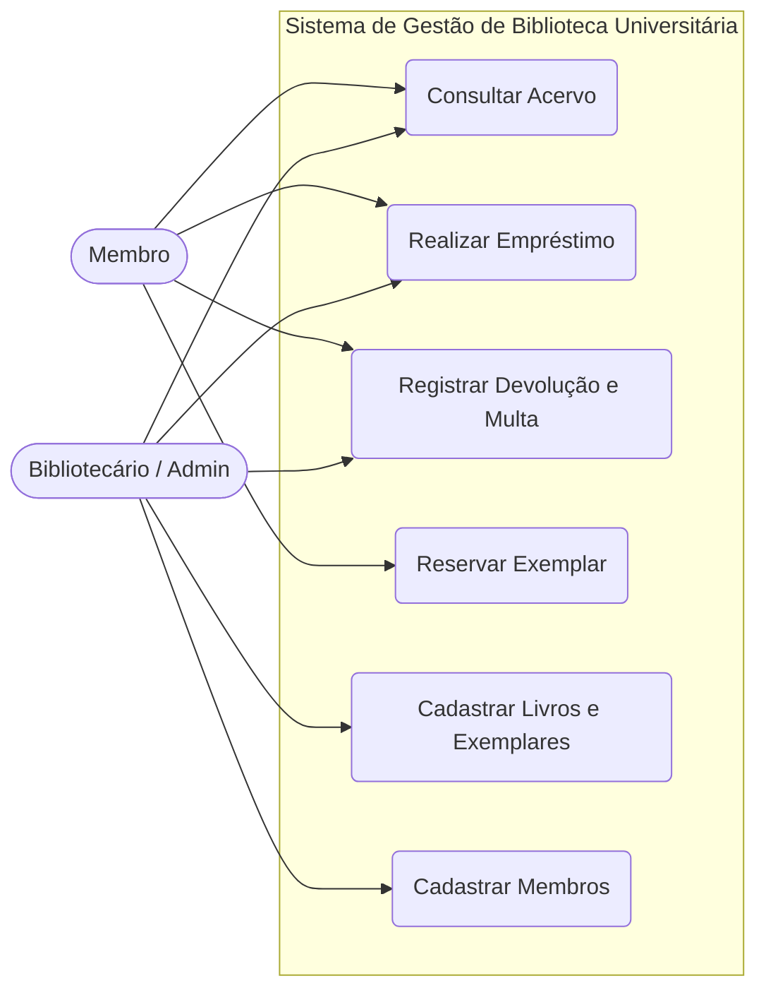

### Casos de Uso em UML

#### Atores Identificados
- **Membro:** Usuário da biblioteca (aluno, professor ou funcionário) que consulta o acervo e solicita empréstimos, 'devoluções e reservas.
- **Bibliotecário / Administrador:** Operador responsável pelo cadastro de livros, exemplares e membros, além de processar empréstimos, devoluções e aplicar multas.

### Especificação dos 3 Cenários Principais

#### Caso de Uso 01: Realizar Empréstimo (UC02)
**Atores:** Membro (solicitante) e Bibliotecário (processador).

**Pré-condições:** O membro deve estar cadastrado e possuir menos de 3 empréstimos ativos; o exemplar físico deve estar disponível no acervo.

**Fluxo Principal:**
1. O Membro solicita o empréstimo de um exemplar físico ao Bibliotecário .
2. O sistema verifica se o membro possui menos de 3 empréstimos ativos .
3. O sistema verifica se o exemplar selecionado está disponível .
4. O sistema registra o empréstimo com a data atual, define o prazo de devolução para 14 dias corridos, altera o status do exemplar para emprestado e incrementa o contador de empréstimos ativos do membro .

**Fluxo Alternativo (FA01 – Limite de empréstimos atingido):** No passo 2, caso o membro já possua 3 empréstimos ativos, o sistema bloqueia a operação e exibe mensagem informando que o limite simultâneo foi atingido .

**Fluxo Alternativo (FA02 – Exemplar indisponível):** No passo 3, caso o exemplar já esteja emprestado, o sistema bloqueia o empréstimo e informa a indisponibilidade (sugerindo a reserva) .

---

#### Caso de Uso 02: Registrar Devolução e Calcular Multa (UC03)
**Atores:** Membro e Bibliotecário .

**Pré-condições:** O exemplar deve constar como emprestado no sistema .

**Fluxo Principal:**
1. O Membro entrega o exemplar físico ao Bibliotecário para devolução .
2. O sistema verifica a data de retirada e compara o total de dias corridos com o prazo padrão de 14 dias .
3. Estando dentro do prazo, o sistema encerra o empréstimo, marca o exemplar como disponível novamente e reduz o contador de empréstimos ativos do membro .

**Fluxo Alternativo (FA01 – Devolução com atraso):** No passo 2, caso o total de dias corridos ultrapasse 14 dias, o sistema calcula a diferença de dias em atraso, multiplica pelo valor diário da multa, exibe o montante a ser aplicado pelo Bibliotecário e conclui a devolução .

---

#### Caso de Uso 03: Reservar Exemplar (UC04)
**Atores:** Membro .

**Pré-condições:** O exemplar desejado deve estar atualmente emprestado .

**Fluxo Principal:**
1. O Membro consulta o acervo e solicita a reserva de um exemplar .
2. O sistema verifica que o exemplar está emprestado no momento .
3. O sistema registra a reserva vinculando o livro, o membro e a data da solicitação .

**Fluxo Alternativo (FA01 – Exemplar disponível):** No passo 2, caso o exemplar esteja disponível na estante, o sistema nega a reserva e orienta o membro a realizar o empréstimo diretamente .

---

### Justificativa de Escopo e Suposições (TP1)

**Recorte de Escopo (Dentro do TP1):** Nesta primeira entrega, o foco foi validar a lógica central das regras de negócio (empréstimo, limite de 3 itens, prazo de 14 dias, cálculo de multa por atraso e trava de reserva) por meio de uma aplicação standalone em console utilizando exclusivamente tipos primitivos, operadores e estruturas de controle de fluxo em Java, além da modelagem inicial de requisitos e casos de uso .

**Fora do Escopo Atual (Etapas Futuras):** Ficaram deliberadamente para os próximos TPs a modelagem Orientada a Objetos (classes `Livro`, `Exemplar`, `Membro`, `Emprestimo`, `Reserva`), persistência em banco de dados, exposição via API REST com Spring Boot, controle de autenticação/autorização por perfil e interfaces gráficas/web .

**Suposições Adotadas:**
1. **Valor diário da multa:** A especificação determina que a multa é cobrada por dia corrido de atraso, mas não estipula um valor monetário . Assumiu-se o valor padrão de **R$ 2,50 por dia de atraso** para fins de simulação no protótipo .
2. **Unificação de regras por tipo de membro:** Embora existam três perfis de membros (aluno, professor e funcionário), a especificação define um prazo padrão único de 14 dias e limite de 3 empréstimos; assumiu-se que essas regras se aplicam igualmente aos três perfis até segunda ordem do cliente/professor .
3. **Granularidade da reserva:** Enquanto a entidade Reserva menciona vínculo com o Livro e a regra de negócio menciona que um Exemplar só pode ser reservado se estiver emprestado, assumiu-se no protótipo a verificação unitária de disponibilidade do exemplar para validar o fluxo lógico .